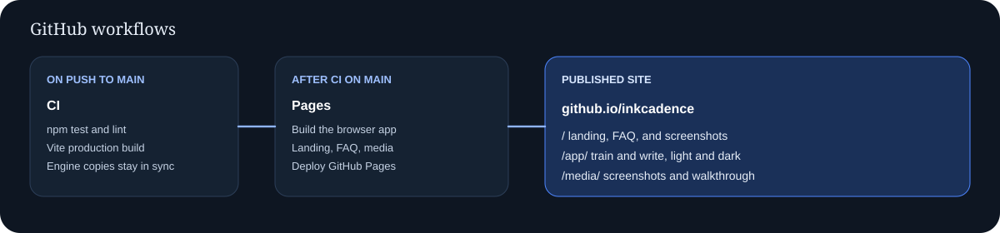

<p align="center">
  
</p>

<p align="center">
  
  
  
  
</p>

<h1 align="center">Inkcadence</h1>

<p align="center">
  <a href="https://mafzalkalwardev.github.io/inkcadence/"><b>▶ Live site</b></a>
  &nbsp;·&nbsp;
  <a href="https://mafzalkalwardev.github.io/inkcadence/classic/"><b>Classic writer</b></a>
  &nbsp;·&nbsp;
  <a href="https://mafzalkalwardev.github.io/inkcadence/app/#/"><b>Vite app</b></a>
</p>

> **Write anything in your own handwriting.** You supply the words. The landing page, the classic writer, and the Vite app are static and run in the browser. Photos stay on the device.

The archived API, database, and neural service are on the [`experimental/backend`](https://github.com/mafzalkalwardev/inkcadence/tree/experimental/backend) branch.

## See it work

The walkthrough below is the **classic writer**: add pages, learn the hand, then render a lined A4 page (zoomed so the hand stays readable).

<p align="center">
  
</p>

### Light and dark

| Light | Dark |
| --- | --- |
|  |  |
|  |  |


### Product workflow


| Pages | Learned hand |
| --- | --- |
|  |  |
| **Write on lined A4** | **Page zoom** |
|  |  |

### GitHub workflows



Pull requests and pushes to `main` run [CI](.github/workflows/ci.yml): one `test` job (lint, tests, engine check, Vite build). Pushes to `main` also run [Pages](.github/workflows/pages.yml), which publishes this guide, the Vite app at `/app/`, and the classic writer at `/classic/`.

## What is in this repo

| Path | Role |
|---|---|
| `docs/` | Landing site, published at `/` |
| `web/` | Vite app, published at `/app/` |
| `js/`, `index.html` | Classic writer, published at `/classic/` |
| `tools/charcnn/` | Trainer for the in-browser letter recogniser (`assets/charcnn.json`) |

## Quick start

**Classic writer (no install):** open `index.html`, or `npx serve . -l 4173`.

**Vite app:**

```bash
npm install --prefix web
npm run dev --prefix web
```

**Letter recogniser weights** (optional, needs PyTorch):

```bash
npm run train:charcnn
```

## Tests

```bash
npm ci
npm run lint
npm test
npm run build --prefix web
```

Pipeline and page-fixture suites need the `canvas` package and skip without it.

## License

MIT
